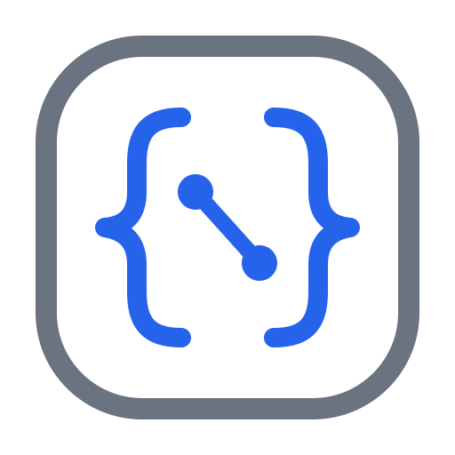
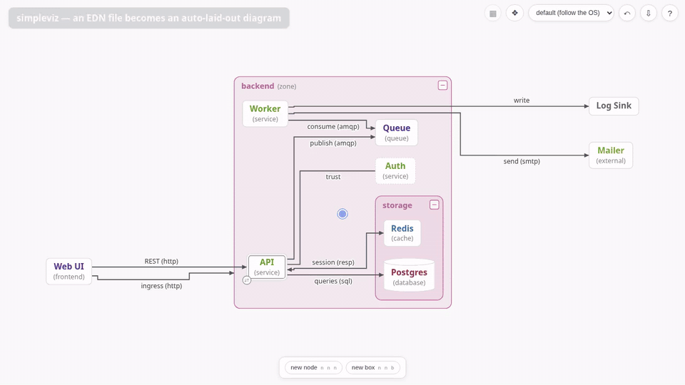

  

<h1 align="center">simpleviz</h1>

  Diagrams, docs and slides from plain markdown and EDN files.

  <a href="docs/documents.md">Documents</a>
  &nbsp;·&nbsp;
  <a href="docs/diagrams.md">Diagrams</a>
  &nbsp;·&nbsp;
  <a href="docs/tables.md">Tables</a>
  &nbsp;·&nbsp;
  <a href="docs/presentations.md">Presentations</a>
  &nbsp;·&nbsp;
  <a href="docs/quizzes.md">Quizzes</a>
  &nbsp;·&nbsp;
  <a href="#install">Install</a>

---

One doc explorer for your project that goes well beyond plain markdown,
built on top of plain formats: markdown (with extensions), EDN, and
other simple, widely used formats like CSV. The files stay readable
without simpleviz — on GitHub, in any editor, to any agent.

**New in 0.42:** [manual layout](docs/guide.md#manual-layout) — ✥ places nodes
and boxes by hand, snapped to a 20 px grid; layered is now the only automatic
layout — [45-second video](docs/assets/whats-new-0.42.mp4)
([gif](docs/assets/whats-new-0.42.gif)).

## Features

- [Documents](docs/documents.md) — md files rendered, edited in place
  (vi keys if you want them), linked to graphs and to each other.
- [Diagrams](docs/diagrams.md) — nodes, edges and nested boxes from an
  EDN file, laid out for you; inspect, edit, compare forks, follow refs,
  export PNG or SVG.
- [Tables](docs/tables.md) — GitHub tables in md files that calculate:
  formulas in cells, formats and colours, over the table or a CSV, JSON
  or EDN file.
- [Presentations](docs/presentations.md) — an md file as slides, a graph,
  doc or picture beside each.
- [Quizzes](docs/quizzes.md) — questions and polls on a slide, the
  answers written to a file an agent can read.

After [installing](#install), open the guided tour, itself an md page
with live graphs and a deck beside it:

    simpleviz ~/.simpleviz/examples/intro.md

## Install

Linux, with [babashka](https://babashka.org/) 1.12 or newer, curl and tar:

    curl -fsSL https://raw.githubusercontent.com/sstoehrm/simpleviz/main/install.sh | bash

This installs into `~/.simpleviz` and puts a launcher in `~/.local/bin`.
`simpleviz update` fetches the latest release.

To install the skills for your agent, run:

    simpleviz update +ai

It installs or updates the Claude Code, Codex and Grok plugins, for
whichever of `claude`, `codex` and `grok` is on your PATH. Their skill
teaches the agent the file formats and the CLI.

With [bbin](https://github.com/babashka/bbin) (tested on Linux), the same
command installs and updates the release jar:

    bbin install https://github.com/sstoehrm/simpleviz/releases/latest/download/simpleviz.jar

Both write `~/.local/bin/simpleviz`, so use one or the other.
`simpleviz clean-all`, which stops every running server, needs the
install.sh launcher on Linux. CI tests only the last two babashka minor
releases (currently 1.12 and 1.13).

Without an installer, unpack a tarball from the
[releases page](https://github.com/sstoehrm/simpleviz/releases) and run
`bb serve examples/demo.edn` inside it (port 7373; `--port N` changes it).

## Usage

    simpleviz demo                             # copy the examples to a temp folder, serve them
    simpleviz my-arch.edn                      # serve a graph on a free port 7370-7469
    simpleviz notes.md                         # an md file, its links to graphs and md files followable
    simpleviz check notes.md                   # an md file's broken links (works without a server)
    simpleviz init my-arch.edn                 # write a starter file
    simpleviz init my-arch.edn -t pipeline     # ...from ~/.simpleviz/templates/pipeline.edn
    simpleviz init talk.md -t presentation     # a slide deck, plus talk.edn for its graph slide
    simpleviz fork my-arch.edn next            # copy to my-arch-next.edn, plus every file it refs
    simpleviz my-arch.edn next                 # compare my-arch.edn → my-arch-next.edn
    simpleviz promote my-arch.edn next         # make the forks the new originals
    simpleviz export my-arch.edn my-arch.png   # the ⇩ export from the terminal (needs Chrome or Chromium)

`--no-open` prints the URL without opening a browser; `simpleviz --help`
lists the rest. Press `?` in the page for controls and shortcuts.

`init` copies a template from `~/.simpleviz/templates` (or
`$SIMPLEVIZ_HOME/templates`): `default.edn` without `-t`, `<name>.edn`
with `-t <name>` — `<name>.md` for an `.md` file, where `{{name}}` becomes
the file's name and each `>> [x](x.edn)` slide gets a starter graph unless
`x.edn` is there. Add your own there, or edit `default.edn`; updates keep
the folder as it is and only add templates it lacks, so delete a shipped
one to get its newest version on the next `simpleviz update`.

## Bug reports

Run with `--debug` to log every edit and error to `~/.simpleviz/logs/`.
Crashes are logged there even without it. Attach the logs to the report
on the [issue tracker](https://github.com/sstoehrm/simpleviz/issues).

## Further documentation

- [Guide](docs/guide.md) — every detail: data format, themes, comparing,
  editing, manual layout, md pages, presenting, questions, refs, pairs,
  exporting, checking files and write locks.
- [Development](docs/development.md) — building, testing and releasing
  simpleviz itself.
