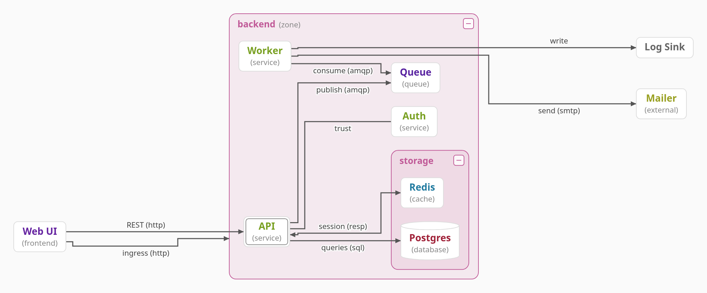

---

# simpleviz

## an md page, presented

Present, top right, shows this file as slides

---

# Slides are split at ---

- A line of just `---` starts the next slide
- → or space steps forward, ← back, Esc leaves
- The first slide is the title slide

---

>> [the demo](demo.edn)

# >> shows a graph beside the text

A slide whose first line is `>> [the demo](demo.edn)` shows that graph on the right. Being a link, Edit marks it with a », and `simpleviz check` reports it when the file is missing.

- Hover a node for its attributes
- Click one to inspect it, read-only
- Drag to pan, scroll to zoom, − collapses a box

---

>> [states](./states.edn)

# Any graph of the folder

The path is relative to this file, like a link.

---

>> [steps](steps.edn)

# A graph with :steps

`steps.edn` lists states of its graph, each a change of the one before. Next, bottom right, animates the graph to its next state.

- What stays moves, what comes fades in
- → still goes to the next slide

---

>> [notes](api/notes.md)

# Another md file

`>> [notes](api/notes.md)` shows it rendered beside the slide.

---

>> 

# Or an image

An exported PNG or SVG opens as the graph it carries; any other picture shows as it is.

---

??? asked

# ?? asks a question

A slide whose first line is `?? name` turns its task list into boxes, `[x]` the right one. `???` waits for Submit before → goes on.

- [ ] Every slide needs one
  > No: a question is a slide that asks for it.
- [x] Answers go to deck.answers.edn
  > Right: beside the deck, so an agent presenting it can read them.
- [ ] Answers are lost on reload
  > No: presenting again reads them back from the file.
